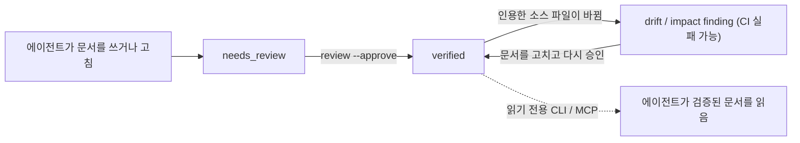

> Language: [English](./README.md) | [한국어](./README.ko.md)

# LLM-WIKI Governance

[](https://www.npmjs.com/package/llm-wiki-governance) [](https://github.com/Dowon-Kim7949/llm-wiki-governance/actions/workflows/ci.yml) [](./LICENSE)

**AI 코딩 에이전트가 쓰고 읽는 프로젝트 지식에 검토 상태와 소스 인용, 드리프트 검사를 붙입니다.**

코딩 에이전트는 프로젝트 문서를 잘 쓰지만, 그 문서가 언제 틀려졌는지는 잘 알아채지 못합니다. LLM-WIKI Governance는 그 지식(`docs/llm-wiki/`의 마크다운 위키)을 코드와 같은 규율 아래 두는, 런타임 의존성 없는 CLI입니다. 에이전트가 쓴 문서는 누군가 승인할 때까지 `needs_review`에 머뭅니다. 문서마다 자신이 설명하는 파일을 인용합니다. 인용한 파일이 바뀌면 그 문서가 표시되고, CI가 그것을 이유로 실패할 수 있습니다. Node.js 18.18 이상이면 돌아가고, Claude Code·Codex·Cursor 같은 에이전트와 함께 쓰며, OKF와 호환됩니다.



1. **뼈대 만들기.** `quickstart --write`가 위키를 만들고, 에이전트를 위키로 안내하는 adapter 파일(`AGENTS.md`, `CLAUDE.md` 등)을 함께 만듭니다.
2. **보강.** 에이전트가 실제 소스를 읽고 문서를 채우며, frontmatter(`source_files`, `evidence`)에 그 소스를 인용합니다. CLI는 인용이 실제로 가리키는 대상이 있는지 확인합니다.
3. **검토.** 문서는 `review --approve`로 `verified` 스탬프를 받기 전까지 `needs_review`에 머뭅니다. 다른 어떤 명령도 문서를 승격하지 않습니다.
4. **감시.** `drift`(검토 날짜 기준)와 `impact`(PR 기준선과의 diff 기준)가, 인용한 소스가 바뀐 `verified` 문서를 표시하고 CI가 그것으로 실패할 수 있습니다.

## 빠른 시작

```bash
npm install -D llm-wiki-governance
npx llm-wiki-governance quickstart --write --type frontend --agent claude   # 또는 --agent codex
```

프로젝트 종류를 알아낸 다음 위키와 adapter 파일을 만들고 handoff 프롬프트를 출력합니다. 그 프롬프트를 에이전트에 붙여넣으면 에이전트가 실제 소스를 근거로 문서를 채우고, 모두 `needs_review`로 남겨 승인을 기다립니다. `quickstart --dry-run`은 무엇이 만들어질지 먼저 보여 주고, `--skills`는 위키에 근거한 에이전트 프롬프트(`bootstrap`·`onboard`·`prepare`·`feature`·`fix`·`docs-sync`·`backfill`)도 만듭니다. 이미 OKF나 평범한 마크다운 지식 폴더가 있다면 형식을 바꿀 필요 없이 `--profile okf-v0.1`로 검증과 CI만 얹으면 됩니다.

CLI에는 모델이 필요 없습니다. 모델이 쓰이는 곳은 보강 단계뿐이고 품질도 거기서 갈리므로, 처음 위키를 만들 때는 가장 강한 추론 모델을 쓰세요.

**코드가 아직 없는 프로젝트를 시작할 때**(`--greenfield`, 1.38.0): `quickstart --write --greenfield`가 요구사항·결정(ADR) 문서를 만들고 계획용 프롬프트를 출력합니다. 에이전트는 사용자가 말한 목적·요구사항·수용 기준·결정만 기록하고, 지어내지 않으며, 소스를 인용하지 않습니다. 요구사항 승인은 계획 승인이지 구현 승인이 아닙니다. `validate`는 연결된 근거가 없는 승인 계획을 info로 보고하고, `stats`는 계획 문서를 따로 셉니다. 코드가 생기면 요구사항마다 소스 파일과 테스트를 `evidence`에 연결하세요. 그때부터는 다른 문서와 똑같이 검사받고, 위의 기존 프로젝트 절차가 그대로 적용됩니다. 나중에 승인된 요구사항이나 결정이 바뀌면 `impact`가 그 문서가 연결한 파일과 각 파일이 같은 diff에서 바뀌었는지를 알려 줍니다(1.39.0, info). 다시 볼 곳을 알려 줄 뿐 판정하지 않습니다. [`examples/greenfield-vue-demo`](https://github.com/Dowon-Kim7949/llm-wiki-governance/tree/main/examples/greenfield-vue-demo)가 빈 저장소에서 이 경로를 돌려 봅니다.

**데모.** [`examples/vue3-typescript-demo`](https://github.com/Dowon-Kim7949/llm-wiki-governance/tree/main/examples/vue3-typescript-demo)는 작은 Vue 3 앱으로 전체 흐름을 임시 git 저장소에서 돌립니다(`npm install && npm run demo`, Node.js 20.19+, API 키 불필요). 소스 근거 문서 2개, `validate --strict`, `review --approve`를 거친 뒤 코드를 바꾸면 문서를 고칠 때까지 `impact`가 exit 1로 끝납니다. 한계도 보여 줍니다. 문서를 *틀린* 숫자로 고쳐도 통과하고, 날짜 기준 `drift`는 검토와 같은 날 커밋된 변경을 놓칩니다.

**다른 스택.** 워크스루 두 개가 더 있습니다. 기존 Python(FastAPI) 서비스([`examples/python-fastapi-brownfield`](https://github.com/Dowon-Kim7949/llm-wiki-governance/tree/main/examples/python-fastapi-brownfield))와 공유 API 계약을 둔 React + Express workspace([`examples/react-node-fullstack`](https://github.com/Dowon-Kim7949/llm-wiki-governance/tree/main/examples/react-node-fullstack))에서 돕니다. 둘 다 Node.js와 git만 있으면 됩니다. 어떤 스택에서 무엇을 확인했는지, 어떻게 재현하는지, 무엇을 아직 보이지 못했는지는 [docs/VALIDATION.ko.md](https://github.com/Dowon-Kim7949/llm-wiki-governance/blob/main/docs/VALIDATION.ko.md)에 있습니다. 루트 매니페스트에 프레임워크가 없는 npm workspace 저장소는 `unknown`으로 감지되고, `init`이 멤버 매니페스트를 보고 `--type`을 제안합니다.

## AGENTS.md나 CLAUDE.md만으로는 왜 부족한가

그 파일들은 그대로 두세요. 이 도구가 그 파일들을 만들고 위키를 가리키게 합니다. 지시 파일은 에이전트에게 일하는 방식을 알려 주지만, 어떤 문장이 검토를 거쳤는지, 어떤 코드에서 나왔는지, 그 뒤로 그 코드가 바뀌었는지는 기록하지 않습니다.

| | 지시 파일만 쓸 때 | LLM-WIKI Governance를 쓸 때 |
| --- | --- | --- |
| 누가 승인했나 | 기록되지 않음 | `needs_review` → `verified`, `reviewed_by`·`reviewed_at`과 함께 |
| 무엇을 근거로 썼나 | 산문 | 인용한 파일·라인 범위·심볼·섹션. 각 인용이 실제로 가리키는 대상이 있는지 검사 |
| 지금도 맞나 | 에이전트가 틀려야 알게 됨 | 인용한 소스가 바뀌면 `drift`·`impact`가 문서를 표시 |
| 강제되나 | 아니오 | `validate`와 `impact`가 pre-commit이나 CI에서 0이 아닌 코드로 종료 |
| 에이전트가 어떻게 읽나 | 매 세션 파일 전체 | 작은 index를 읽고, CLI나 MCP의 순위 매긴 키워드 검색으로 필요한 부분만 |

## 하지 않는 일

- **산문이 참인지는 검사하지 않습니다.** 인용이 대상을 가리키는지만 봅니다. 파일이 있는지, 라인 범위가 파일 안에 있는지, 심볼이 언급되는지, 섹션 헤딩이 있는지입니다. 문장이 맞는지는 여전히 검토자가 판단합니다.
- **문서를 대신 쓰지 않습니다.** CLI는 뼈대를 만들고 검사하고 프롬프트를 출력합니다. 내용은 에이전트가 씁니다.
- **누가 승인했는지 증명하지 못합니다.** `reviewed_by`에는 `review --approve`에 넘긴 이름이 기록될 뿐입니다. 에이전트 이름을 `agentReviewers`에 적어 두면 `stats`가 그 승인을 따로 셉니다. 누가 머지할 수 있는지는 이 도구가 아니라 브랜치 보호가 정합니다. 이 저장소의 위키는 유지보수자의 기록된 결정에 따라 에이전트가 승인합니다([AGENTS.md](./AGENTS.md)).
- **의미 검색이 아닙니다.** 조회는 키워드 일치를 BM25로 순위 매기는 방식이고, 임베딩도 인덱스 서비스도 없습니다. 호스팅 서비스도 아니어서 CLI가 스스로 네트워크를 호출하지 않습니다.
- **변경 감지는 대부분 파일 단위입니다.** `impact`와 `drift`는 라인 범위나 마크다운 섹션으로 인용한 경우만 그 영역으로 좁히고, 1.39.0부터 `drift`는 검토를 기록한 커밋도 동의할 때만 좁힙니다. 날짜 기준 `drift`에는 머지 방식에 따른 사각지대도 있습니다. [Wiring the gate](https://github.com/Dowon-Kim7949/llm-wiki-governance/blob/main/docs/OPERATIONS.md#wiring-the-gate-the-step-most-repos-skip)(영문)를 보세요.

## 명령

| 명령 | 하는 일 |
| --- | --- |
| `quickstart` · `init` | 위키와 adapter 파일을 만들고 에이전트 handoff 프롬프트를 출력합니다. |
| `validate` · `audit` · `status` | 로컬과 CI에서 쓰는 구조·안전 검증 · 전체 finding 리포트 · 현재 위키 상태. |
| `drift` · `impact` | 인용한 소스가 움직인 문서를 표시합니다. 앞은 날짜 기준, 뒤는 PR 기준선과의 diff 기준입니다. |
| `review` | `needs_review` 백로그를 위험도 순으로 보여 줍니다. `verified`로 가는 길은 `--approve`뿐입니다. |
| `mode` · `backfill` | 거버넌스 레벨을 읽고 바꿉니다 · 저장소가 증명할 수 있는 것으로 불완전한 위키를 다시 세웁니다. |
| `onboard` · `prepare` | 업무 영역을 익히거나, 구현 전에 작업 범위를 훑습니다. 읽기 전용입니다. |
| `list-docs` · `search-docs` · `get-doc` · `get-related` | 문서 본문을 돌려주는 읽기 전용 조회입니다. 민감해 보이는 값은 가려서 나옵니다. |
| `graph` · `stats` | 지식 그래프(text/JSON/Mermaid/DOT) · 헬스 스냅샷. |
| `doctor` · `next` · `explain` | 런타임·감지·CI 배선 점검 · 다음 할 일 제안 · finding 설명. |
| `mcp` | 읽기 전용 MCP 서버를 띄웁니다. |
| `fix` · `migrate` · `archive-log` · `handoff` · `prompt` · `check-run` · `harness-health` · `import-memory` | 범위를 한정한 자동 수정, 문서 계약 업그레이드, 변경 로그 월별 보관, 에이전트 프롬프트, 하네스 점검입니다. |

쓰기는 `--write`, `--apply`, `--approve`, `drift --downgrade`, `--out <파일>`을 직접 줬을 때만 일어납니다. 그 밖의 명령과 모든 MCP 툴은 읽기만 합니다. `--lang ko`는 findings를 한국어로, `--doc-lang ko`는 생성되는 위키 본문을 한국어로 만듭니다. CLI를 spawn하는 대신 패키지를 import해서 쓸 수도 있습니다(`import { commands, run } from "llm-wiki-governance"`). 전체 참조는 `npx llm-wiki-governance help <command>`(영문, 오프라인)이고, `--version`은 설치된 버전만 출력합니다.

## CI에서 돌리기

[`templates/github-actions/llm-wiki-validate.yml`](https://github.com/Dowon-Kim7949/llm-wiki-governance/blob/main/templates/github-actions/llm-wiki-validate.yml)을 복사하거나, 컴포지트 액션을 한 스텝으로 쓰세요: `uses: Dowon-Kim7949/llm-wiki-governance/.github/actions/validate@v1.41.0`. 리포트를 job summary에 붙이고, 거기에 `impact`가 다시 검토하라는 문서 목록도 들어갑니다(`summary: "false"`로 끔). 비공개 저장소라면 러너 없이 도는 `templates/git-hooks/pre-commit` 훅과 `LLM_WIKI_RUNNER` 변수(self-hosted 러너)로 조직이 나눠 쓰는 러너 시간을 아낄 수 있습니다. 저장소 규모별 레시피는 [docs/OPERATIONS.md](https://github.com/Dowon-Kim7949/llm-wiki-governance/blob/main/docs/OPERATIONS.md)(영문)에 있습니다.

## 거버넌스 모드

검사 엔진은 하나이고 정책 수위만 세 단계입니다. `llm-wiki.config.json`의 `{ "governance": { "mode": "lite" } }`로 언제든 바꿀 수 있습니다.

| | `lite` | `standard` | `strict` |
| --- | --- | --- | --- |
| 무엇을 우선하나 | 개발 속도 | 속도와 지식을 함께 | 완전성과 검증, 인수인계 |
| 코드를 고친 뒤 문서 작업 | 코드만 봐서는 알 수 없는 것만 | 도메인·아키텍처·계약이 움직였을 때 | 영향받은 문서 전부 |
| 드리프트와 문서 누락 게이트 | 끕니다 | 보고만 합니다(warning) | 빌드를 실패시킵니다(error) |

`quickstart`는 `lite`를 깔아 둡니다. `governance` 블록이 없는 설정은 `strict`로 해소되며, 모드가 생기기 전 규칙 집합과 같습니다. 구조 검사와 안전 검사는 어느 모드에서도 돕니다. 모드가 끈 규칙은 보고하지 않을 뿐입니다. `stats`와 `next`는 보강 여부와 근거를 그대로 측정하고, `review`는 채우지 않은 뼈대 문서를 여전히 승인하지 않습니다. 의도한 사용법은 몇 달을 `lite`로 지내다 인수인계 전에 `mode set strict --write`와 `backfill`을 돌리는 것입니다. **`impact`를 필수 체크에 넣기 전에:** `strict`에서는 `impact.source_changed`가 `error`라서 `impact --since <ref>`만으로 빌드가 실패합니다. `standard`를 쓰거나 `rules`에 `"impact.source_changed": "warning"`을 넣으세요.

## 에이전트 연동 (MCP)

`llm-wiki mcp`는 Node 내장 모듈만으로 stdio 위에 [Model Context Protocol](https://modelcontextprotocol.io) 서버를 띄웁니다.

```json
{ "mcpServers": { "llm-wiki": { "command": "npx", "args": ["-y", "llm-wiki-governance", "mcp"] } } }
```

툴은 전부 읽기 전용이고 `verified` 승격은 CLI에서만 일어납니다. 인증 기능이 없고 `cwd` 인자도 샌드박스가 아니니 로컬 서브프로세스로만 쓰세요([SECURITY.ko.md](.github/SECURITY.ko.md#mcp-서버-신뢰-모델)). 1.40.0 이전 버전은 `validate`를 통해 파일을 쓰게 만들 수 있었으니 올리세요.

## 도입과 운영에 드는 것

설정은 `quickstart --write` 한 번과 보강 세션 한 번입니다. 평소에는 `drift`나 `impact`가 문서를 표시하면 고치고 다시 승인합니다. **가치는 도구가 아니라 유지된 내용에서 나옵니다.** 저희 벤치마크(외부 저장소 1개, 모델 1개, 과제 6개)에서, 만들어만 두고 보강하지 않은 위키는 위키가 없을 때보다 *오히려 나쁘게* 측정됐습니다. 조건과 불리하게 나온 실행까지 [BENCHMARK.md](https://github.com/Dowon-Kim7949/llm-wiki-governance/blob/main/docs/llm-wiki/BENCHMARK.md)와 [BENCHMARK_DISCLOSURE.ko.md](https://github.com/Dowon-Kim7949/llm-wiki-governance/blob/main/docs/BENCHMARK_DISCLOSURE.ko.md)에 있습니다.

Windows·macOS·Linux에서 런타임 의존성 없이 돕니다. Node·Python·Go·Rust·JVM·PHP·Ruby·.NET·모바일·인프라 프로젝트를 감지하고, Codex·Claude Code·Cursor·GitHub Copilot·Windsurf·Gemini CLI용 adapter를 제공합니다.

## 문제 해결과 문서 안내

| 이럴 때 | 이렇게 |
| --- | --- |
| `npx`가 옛 버전을 실행함 | `npx`는 캐시를 재사용할 수 있습니다. `npx llm-wiki-governance@latest …`로 실행하고 `--version`으로 확인하세요. |
| 처음 보는 finding | `llm-wiki explain <rule>` |
| 설정이나 CI 배선이 맞는지 모르겠음 | `llm-wiki doctor` |
| `sensitive.redacted`가 문서를 막음 | [When the sensitive-info scan blocks you](https://github.com/Dowon-Kim7949/llm-wiki-governance/blob/main/docs/OPERATIONS.md#when-the-sensitive-info-scan-blocks-you)(영문) |
| 모든 명령·옵션·exit code | [PUBLIC_API.md](https://github.com/Dowon-Kim7949/llm-wiki-governance/blob/main/docs/llm-wiki/PUBLIC_API.md) · `help <command>`(영문) |
| 신뢰 모델, 취약점 제보 | [SECURITY.ko.md](.github/SECURITY.ko.md) |
| 보안 수정 받기 | 보안 수정은 최신 릴리스에만 들어갑니다. `npm install -D llm-wiki-governance@latest` 후 `--version`으로 확인하세요. |
| 실사용 예시 | [EXAMPLES.md](https://github.com/Dowon-Kim7949/llm-wiki-governance/blob/main/docs/llm-wiki/EXAMPLES.md) |
| 출시 이력, 방향, 결정 기록 | [CHANGELOG.ko.md](./docs/CHANGELOG.ko.md) · [ROADMAP.ko.md](./docs/ROADMAP.ko.md) · [GATE_REVIEW.md](./docs/GATE_REVIEW.md)(영문) |

버그 제보와 질문은 [Issues](https://github.com/Dowon-Kim7949/llm-wiki-governance/issues)와 [Discussions](https://github.com/Dowon-Kim7949/llm-wiki-governance/discussions)에 남겨 주세요. 풀 리퀘스트 전에 [CONTRIBUTING.ko.md](.github/CONTRIBUTING.ko.md)와 [행동 강령](.github/CODE_OF_CONDUCT.ko.md)을 읽어 주세요. 라이선스는 [MIT](./LICENSE)입니다.
