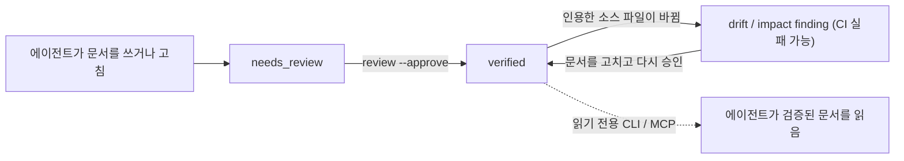

> Language: [English](./README.md) | [한국어](./README.ko.md)

# LLM-WIKI Governance

[](https://www.npmjs.com/package/llm-wiki-governance) [](https://github.com/Dowon-Kim7949/llm-wiki-governance/actions/workflows/ci.yml) [](./LICENSE)

**AI 코딩 에이전트가 쓰고 읽는 프로젝트 지식에 검토 상태와 소스 인용, 드리프트 검사를 붙입니다.**

코딩 에이전트는 프로젝트 문서를 잘 쓰지만, 그 문서가 언제 틀려졌는지는 잘 알아채지 못합니다. LLM-WIKI Governance는 그 지식(`docs/llm-wiki/`의 마크다운 위키)을 코드와 같은 규율 아래 두는, 런타임 의존성 없는 CLI입니다. 에이전트가 쓴 문서는 누군가 승인할 때까지 `needs_review`에 머뭅니다. 문서마다 자신이 설명하는 파일을 인용합니다. 인용한 파일이 바뀌면 그 문서가 표시되고, CI가 그것을 이유로 실패할 수 있습니다. Node.js 18.18 이상이면 돌아가고, Claude Code·Codex·Cursor 같은 에이전트와 함께 쓰며, OKF와 호환됩니다.

```text
기존 방식:        작업 -> 코드베이스 재탐색 -> 구조·규칙 재파악 -> 작업 수행
LLM-WIKI 방식:    작업 -> index.md 확인 -> 관련 (검증된) wiki 문서 확인 -> 필요한 소스만 확인 -> 작업 수행
```

## 동작 방식



1. **뼈대 만들기.** `quickstart --write`가 위키를 만들고, 에이전트를 위키로 안내하는 adapter 파일(`AGENTS.md`, `CLAUDE.md` 등)을 함께 만듭니다.
2. **보강.** 에이전트가 실제 소스를 읽고 문서를 채우며, frontmatter(`source_files`, `evidence`)에 그 소스를 인용합니다. CLI는 인용이 실제로 가리키는 대상이 있는지 확인합니다.
3. **검토.** 문서는 `review --approve`로 `verified` 스탬프를 받기 전까지 `needs_review`에 머뭅니다. 다른 어떤 명령도 문서를 승격하지 않습니다.
4. **감시.** `drift`(검토 날짜 기준)와 `impact`(PR 기준선과의 diff 기준)가, 인용한 소스가 바뀐 `verified` 문서를 표시합니다. `validate`와 `impact`를 CI에 걸어 두면 낡은 문서가 조용히 틀린 채로 남는 대신 빌드가 실패합니다.

## 빠른 시작

```bash
npm install -D llm-wiki-governance
npx llm-wiki-governance quickstart --write --type frontend --agent claude   # 또는 --agent codex
```

`quickstart --write`는 프로젝트 종류를 알아낸 다음 위키와 adapter 파일을 만들고, 마지막에 handoff 프롬프트를 출력합니다. 그 프롬프트를 에이전트에 붙여넣으면 에이전트가 `docs/llm-wiki/index.md`부터 읽고 실제 소스를 근거로 문서를 채웁니다. 채워진 문서는 모두 `needs_review`로 남아 검토를 기다립니다. 무엇이 만들어지는지 먼저 보려면 `quickstart --dry-run`을 쓰세요.

`--skills`를 더하거나 `--agent claude|codex|cursor`를 지정하면 `bootstrap`·`onboard`·`prepare`·`feature`·`fix`·`docs-sync`·`backfill` 작업용 자동화 프롬프트까지 만들어 줍니다. 이미 OKF나 평범한 마크다운으로 지식 폴더를 갖고 계시다면 형식을 바꿀 필요가 없습니다. 그 폴더에 그대로 CLI를 대면 `--profile okf-v0.1`이 검증과 드리프트 감지, CI만 얹어 줍니다.

CLI를 돌리는 데는 모델이 필요 없습니다. 모델이 쓰이는 곳은 보강 단계 하나뿐이고 결과 품질도 거기서 갈립니다. 처음 위키를 만들 때는 쓰시는 에이전트의 가장 강한 추론 모델을 쓰고, 이후 `docs-sync` 같은 일상 작업은 값싼 모델로 돌리시면 됩니다.

## 데모 앱으로 해 보기

[`examples/vue3-typescript-demo`](https://github.com/Dowon-Kim7949/llm-wiki-governance/tree/main/examples/vue3-typescript-demo)는 작은 Vue 3 + TypeScript 할 일 목록 앱과, 그 소스를 보고 쓴 위키입니다. 전체 흐름을 한 번에 보여 줍니다. `init`, 소스 근거 문서 2개, `validate --strict`, `review --approve`를 거친 뒤 코드를 바꾸면(제목 상한 80 → 120), 문서를 고치고 다시 승인할 때까지 `impact`가 exit 1로 끝납니다.

```bash
git clone https://github.com/Dowon-Kim7949/llm-wiki-governance.git
cd llm-wiki-governance/examples/vue3-typescript-demo
npm install
npm run demo    # 임시 git 저장소에서 모든 단계를 실행하고 "All 11 checks passed."로 끝납니다
```

Node.js 20.19+(Vite 요구사항)와 git이 필요하고, API 키나 AI 서비스는 필요 없습니다. 데모 README에 같은 단계를 직접 따라 하는 방법이 있고, 한계도 보여 줍니다. `impact`는 파일 단위라 문서를 *틀린* 숫자로 고쳐도 통과하고, 날짜 기준 `drift`는 리뷰와 같은 날 커밋된 변경을 놓칩니다.

## AGENTS.md나 CLAUDE.md만으로는 왜 부족한가

그 파일들은 그대로 두세요. 이 도구가 그 파일들을 만들어 주고 위키를 가리키게 합니다. 지시 파일은 에이전트에게 일하는 방식을 알려 줍니다. 하지만 어떤 문장이 검토를 거쳤는지, 어떤 코드에서 나왔는지, 그 뒤로 그 코드가 바뀌었는지는 기록하지 않습니다. 이 도구가 더하는 것이 바로 그 기록입니다.

| | 지시 파일만 쓸 때 | LLM-WIKI Governance를 쓸 때 |
| --- | --- | --- |
| 누가 승인했나 | 기록되지 않음 | `needs_review` → `verified`, `reviewed_by`·`reviewed_at`과 함께 |
| 무엇을 근거로 썼나 | 산문 | 인용한 파일·라인 범위·심볼·섹션. 각 인용이 실제로 가리키는 대상이 있는지 검사 |
| 지금도 맞나 | 에이전트가 틀려야 알게 됨 | 인용한 파일이 바뀌면 `drift`·`impact`가 문서를 표시 |
| 강제되나 | 아니오 | `validate`와 `impact`가 pre-commit이나 CI에서 0이 아닌 코드로 종료 |
| 에이전트가 어떻게 읽나 | 매 세션 파일 전체 | 작은 index를 읽고, CLI나 MCP로 필요한 부분만 |

## 무엇을 해 주나

- **신뢰 상태.** AI가 쓴 문서는 `needs_review`로 시작합니다. 문서를 `verified`로 올리는 길은 명시적인 `review --approve` 하나뿐이고, 다른 명령이나 MCP 툴은 할 수 없습니다.
- **검사되는 인용.** 문서는 파일·라인 범위·심볼·마크다운 섹션을 인용하고, 인용이 더 이상 대상을 가리키지 못하면 `validate`가 실패합니다.
- **드리프트와 영향 분석.** 인용한 소스가 바뀌면 `drift`와 `impact`가 그 `verified` 문서를 재검토 대상으로 표시합니다.
- **CI 강제.** `validate`와 `impact`가 0이 아닌 코드로 끝나므로, pre-commit이나 GitHub Actions에서 검토되지 않았거나 낡은 위키를 막을 수 있습니다. 얼마나 세게 막는지는 [거버넌스 모드](#거버넌스-모드)에 따라 다릅니다.
- **에이전트의 질의.** CLI와 MCP로 읽기 전용 조회를 할 수 있고, 민감해 보이는 줄은 가려서 나옵니다.
- **구조적 안전.** 쓰기는 항상 미리보기가 먼저입니다. 변경 로그는 append-only이고, 민감해 보이는 값은 경고로 넘기지 않고 검사를 막습니다. 런타임 의존성은 없습니다.

## 하지 않는 일

- **산문이 참인지는 검사하지 않습니다.** 검사하는 것은 인용이 대상을 가리키는지입니다. 파일이 있는지, 라인 범위가 파일 안에 있는지, 심볼이 언급되는지, 섹션 헤딩이 있는지를 봅니다. 그 인용을 단 문장이 맞는지는 여전히 검토자가 판단합니다.
- **문서를 대신 쓰지 않습니다.** CLI는 뼈대를 만들고, 검사하고, 프롬프트를 출력합니다. 내용은 에이전트가 쓰고, 품질도 그 단계에서 정해집니다.
- **누가 승인했는지 증명하지 못합니다.** `reviewed_by`에는 `review --approve`에 넘긴 이름이 기록될 뿐입니다. 저장소에서 에이전트가 문서를 승인한다면 `llm-wiki.config.json`의 `agentReviewers`에 그 이름을 적어 두세요. 그러면 `stats`가 에이전트 승인을 따로 셉니다. 누가 머지할 수 있는지를 통제하는 것은 이 도구가 아니라 브랜치 보호입니다. 이 저장소의 위키가 그 예입니다. 유지보수자의 기록된 결정에 따라 에이전트가 자기 이름으로 승인하고([AGENTS.md](./AGENTS.md)), `stats`는 그 승인을 사람 승인과 따로 셉니다.
- **의미 검색이 아닙니다.** 조회는 위키에 대한 키워드 검색입니다. 임베딩도, 인덱스 서비스도 없습니다.
- **호스팅 서비스가 아닙니다.** 여러분의 컴퓨터나 CI에서 돕니다. CLI가 스스로 네트워크를 호출하는 일은 없습니다.
- **드리프트 감지는 파일 단위이고, 날짜 기준 검사에는 머지 방식에 따른 사각지대가 있습니다.** `impact --since <base>`는 diff 기준이라 그 문제가 없습니다. 자세한 내용은 [Wiring the gate](https://github.com/Dowon-Kim7949/llm-wiki-governance/blob/main/docs/OPERATIONS.md#wiring-the-gate-the-step-most-repos-skip)(영문)에 있습니다.

## 명령

| 명령 | 하는 일 |
| --- | --- |
| `quickstart` · `init` | 위키와 adapter 파일을 만들고 에이전트 handoff 프롬프트를 출력합니다. |
| `validate` · `audit` · `status` | 로컬과 CI에서 쓰는 구조·안전 검증 · 전체 finding 리포트 · 현재 위키 상태. |
| `drift` · `impact` | 인용한 소스가 움직인 문서를 표시합니다. 앞은 날짜 기준, 뒤는 PR 기준선과의 diff 기준입니다. |
| `review` | `needs_review` 백로그를 위험도 순으로 보여 줍니다. `verified`로 가는 길은 `--approve`뿐입니다. |
| `mode` · `backfill` | 거버넌스 레벨을 읽고 바꿉니다 · 저장소가 증명할 수 있는 것으로 불완전한 위키를 다시 세웁니다. |
| `onboard` · `prepare` | 업무 영역을 익히거나, 구현 전에 작업 범위를 훑습니다. 읽기 전용입니다. |
| `list-docs` · `search-docs` · `get-doc` · `get-related` | 문서 본문을 돌려주는 읽기 전용 조회입니다. 민감해 보이는 줄은 가려서 나옵니다. |
| `graph` · `stats` | 지식 그래프(text/JSON/Mermaid/DOT) · 헬스 스냅샷. |
| `doctor` · `next` · `explain` | 런타임·프로젝트 감지·CI 배선 점검 · 다음 할 일 제안 · finding의 의미와 고치는 법 설명. |
| `mcp` | 읽기 전용 MCP 서버를 띄웁니다. |
| `fix` · `migrate` · `archive-log` · `handoff` · `prompt` · `check-run` · `harness-health` · `import-memory` | 범위를 한정한 자동 수정, 문서 계약 업그레이드, 변경 로그 월별 보관, 에이전트 프롬프트, 하네스 점검입니다. |

쓰기는 `--write`나 `--apply`, `--approve`를 직접 줬을 때만 일어나고 나머지는 전부 읽기 전용입니다. `--lang ko`를 붙이면 findings 메시지가 한국어로 나오고, `--doc-lang ko`를 붙이면 생성되는 위키 본문이 한국어가 됩니다. CLI를 spawn하는 대신 패키지를 import해서 쓸 수도 있습니다(`import { commands, run } from "llm-wiki-governance"`). 명령과 옵션, exit code를 전부 보려면 `npx llm-wiki-governance help <command>`를 오프라인으로 돌리거나 [PUBLIC_API.md](https://github.com/Dowon-Kim7949/llm-wiki-governance/blob/main/docs/llm-wiki/PUBLIC_API.md)를 보세요.

## CI에서 돌리기

[`templates/github-actions/llm-wiki-validate.yml`](https://github.com/Dowon-Kim7949/llm-wiki-governance/blob/main/templates/github-actions/llm-wiki-validate.yml)을 복사하거나, 컴포지트 액션을 한 스텝으로 참조하되 태그를 정확히 고정하세요: `uses: Dowon-Kim7949/llm-wiki-governance/.github/actions/validate@v1.35.0`. 저장소 규모별 레시피는 [docs/OPERATIONS.md](https://github.com/Dowon-Kim7949/llm-wiki-governance/blob/main/docs/OPERATIONS.md)(영문)에 있습니다.

1.35.0부터 컴포지트 액션은 text 리포트를 job summary에도 붙입니다(`summary: "false"`로 끌 수 있고, 스텝의 종료 코드는 그대로입니다). `impact`의 리포트에는 다시 검토할 문서와 각 문서가 인용하는 바뀐 소스를 정리한 표가 들어가고, `--format json`에는 같은 내용이 `impactedDocuments`로 실립니다.

비공개 저장소라면 러너 사용 시간이 조직 전체가 나눠 쓰는 한도에서 빠져나갑니다. 비용이 들지 않는 경로가 두 가지 있습니다. 러너 없이 도는 `templates/git-hooks/pre-commit`을 쓰거나, 워크플로 템플릿의 `runs-on`을 `LLM_WIKI_RUNNER` 변수로 바꿔 파일을 고치지 않고 self-hosted 러너에 붙이는 것입니다. 각각이 무엇을 포기하는지는 OPERATIONS.md에 있습니다.

## 거버넌스 모드

문서를 얼마나 갖춰 둘지는 그 프로젝트가 지금 어느 단계에 있느냐에 따라 달라져야 합니다. 그래서 검사 엔진은 그대로 두고 정책 수위만 세 단계로 나눴습니다. 같은 저장소 안에서 언제든 올리고 내릴 수 있습니다.

| | `lite` | `standard` | `strict` |
| --- | --- | --- | --- |
| 무엇을 우선하나 | 개발 속도 | 속도와 지식을 함께 | 완전성과 검증, 인수인계 |
| 코드를 고친 뒤 문서 작업 | 코드만 봐서는 알 수 없는 것만 | 도메인·아키텍처·계약이 움직였을 때 | 영향받은 문서 전부 |
| 드리프트와 문서 누락 게이트 | 끕니다 | 보고만 합니다(warning) | 빌드를 실패시킵니다(error) |
| `audit` · `backfill` | 필요할 때만 | 필요할 때만 | 핵심 워크플로 |

```json
{ "governance": { "mode": "lite" } }
```

`init`과 `quickstart`는 새 프로젝트에 `lite`를 깔아 둡니다. 그래서 막 설정한 저장소는 모드를 올리기 전까지 드리프트 때문에 빌드가 실패하지 않습니다. `governance` 블록이 아예 없는 프로젝트는 `strict`로 해소되는데, 그 규칙 집합은 모드가 생기기 전에 이 CLI가 강제하던 것과 정확히 같습니다. 그러니 버전을 올려도 직접 켜기 전까지는 달라지는 게 없습니다. 구조 검사와 안전 검사는 어느 모드에서도 그대로 돕니다. 깨진 frontmatter, 실제로 없는 `source_files` 경로, 끊어진 링크, 민감정보 탐지는 모드를 낮춘다고 함께 낮아지지 않습니다.

의도한 사용법은 평소 몇 달을 `lite`로 지내다가 인수인계를 앞두고 `strict`로 올리는 것입니다. `llm-wiki mode set strict --write`는 설정 키 하나만 쓰고 스캔을 돌리지 않습니다. 비싼 재구성은 `llm-wiki backfill`을 직접 부를 때만 일어납니다. `backfill`은 모든 사실에 `verified`·`inferred`·`unknown` 라벨을 달고, 아무도 남기지 않은 근거를 지어내지 않습니다.

**`impact`를 필수 체크에 넣기 전에 읽어 주세요.** `strict`에서는 `impact.source_changed`가 기본 `error`라서 `llm-wiki impact --since <ref>`가 아무 플래그 없이도 빌드를 실패시킵니다. `governance.mode`를 `standard`(보고만)나 `lite`(끔)로 두거나, `llm-wiki.config.json`의 `rules`에 `"impact.source_changed": "warning"`을 넣으면 됩니다. 배경과 실측 오탐률, 되돌리는 방법 전부는 [CHANGELOG.ko.md](./CHANGELOG.ko.md)의 1.28.0 항목에 있습니다.

## 에이전트 연동 (MCP)

`llm-wiki mcp`는 stdio 위에서 [Model Context Protocol](https://modelcontextprotocol.io) 서버를 띄웁니다. Node 내장 모듈만 씁니다. MCP 클라이언트에는 이렇게 등록합니다.

```json
{ "mcpServers": { "llm-wiki": { "command": "npx", "args": ["-y", "llm-wiki-governance", "mcp"] } } }
```

노출되는 툴은 전부 읽기 전용입니다. 에이전트가 위키를 조회할 수는 있어도 쓰지는 못하고, `verified` 승격은 CLI에서만 일어납니다. 이 서버는 로컬 stdio 서브프로세스로 도는 것을 전제하고 인증 기능이 없으니, 직접 인증 프록시를 두지 않은 채로 네트워크에 노출하지 마세요. 신뢰 모델은 [SECURITY.ko.md](./SECURITY.ko.md#mcp-서버-신뢰-모델)에 있습니다.

## 도입과 운영에 드는 것

- **설정:** `quickstart --write` 한 번, 그리고 에이전트와 보강 세션 한 번이면 됩니다. 모델 비용과 결과 품질은 그 세션에서 정해집니다.
- **일상:** `drift`나 `impact`가 문서를 표시하면 문서를 고치고 다시 승인합니다. `lite`에서는 코드만 봐서는 알 수 없는 것만 문서로 남기면 됩니다.
- **CI:** 잡 하나, 또는 러너가 필요 없는 pre-commit 훅이면 됩니다.
- **가치는 도구가 아니라 유지된 내용에서 나옵니다.** 저희가 돌린 벤치마크(외부 저장소 1개, 모델 1개, 과제 6개)에서, 만들어만 두고 보강하지 않은 위키는 위키가 아예 없을 때보다 *오히려 나쁘게* 측정됐습니다. 측정 조건과 불리하게 나온 실행까지 [BENCHMARK.md](https://github.com/Dowon-Kim7949/llm-wiki-governance/blob/main/docs/llm-wiki/BENCHMARK.md)와 [BENCHMARK_DISCLOSURE.ko.md](https://github.com/Dowon-Kim7949/llm-wiki-governance/blob/main/docs/BENCHMARK_DISCLOSURE.ko.md)에 있습니다.

## 지원 환경

| | |
| --- | --- |
| **런타임** | Node.js 18.18.0 이상 · Windows, macOS, Linux |
| **의존성** | 없습니다. 런타임 서드파티 의존성이 하나도 없습니다 |
| **감지 대상** | Node · Python · Go · Rust · JVM · PHP · Ruby · .NET · 모바일(Android / Flutter / iOS / React Native) · 인프라(Docker / Compose / Kubernetes / Helm / Terraform) |
| **표준** | OKF 호환입니다. `--profile okf-v0.1`이 Open Knowledge Format의 `type`·`aliases`·`tags`를 검증합니다 |
| **에이전트/에디터** | Codex(`AGENTS.md`), Claude Code(`CLAUDE.md`), Cursor, GitHub Copilot, Windsurf, Gemini CLI용 adapter 파일, 그리고 모든 MCP 클라이언트 |
| **단독 사용** | CLI는 에이전트 없이도 그대로 동작합니다 |

## 문제 해결

| 증상 | 먼저 해 볼 것 |
| --- | --- |
| `npx`가 최신 릴리스보다 옛 버전을 실행함 | npx는 캐시된 사본을 재사용할 수 있습니다. `npx llm-wiki-governance@latest …`로 실행하거나 devDependency로 설치하세요. |
| 처음 보는 finding | `llm-wiki explain <rule>`이 의미와 안전한 고치는 법을 알려 줍니다. |
| 설정이나 CI 배선이 맞는지 모르겠음 | `llm-wiki doctor`가 런타임·감지 결과와, CI 스텝 중 실제로 빌드를 막을 수 있는 것이 몇 개인지 보여 줍니다. |
| `sensitive.redacted`가 문서를 막음 | [When the sensitive-info scan blocks you](https://github.com/Dowon-Kim7949/llm-wiki-governance/blob/main/docs/OPERATIONS.md#when-the-sensitive-info-scan-blocks-you)(영문) |
| 예상하지 못한 `impact` 빌드 실패 | `governance.mode`를 확인하고 [거버넌스 모드](#거버넌스-모드)를 보세요. |

## 문서 안내

| 이럴 때 | 읽을 문서 |
| --- | --- |
| 저장소 규모에 맞춰 운영하고 CI에 연결하기 | [docs/OPERATIONS.md](https://github.com/Dowon-Kim7949/llm-wiki-governance/blob/main/docs/OPERATIONS.md)(영문) |
| 모든 명령·옵션·exit code 찾아보기 | [PUBLIC_API.md](https://github.com/Dowon-Kim7949/llm-wiki-governance/blob/main/docs/llm-wiki/PUBLIC_API.md) · `npx llm-wiki-governance help <command>`(영문) |
| 신뢰 모델 이해하기, 취약점 제보하기 | [SECURITY.ko.md](./SECURITY.ko.md) |
| 무엇을 쟀고 무엇은 재지 못했는지 보기 | [BENCHMARK.md](https://github.com/Dowon-Kim7949/llm-wiki-governance/blob/main/docs/llm-wiki/BENCHMARK.md) · [BENCHMARK_DISCLOSURE.ko.md](https://github.com/Dowon-Kim7949/llm-wiki-governance/blob/main/docs/BENCHMARK_DISCLOSURE.ko.md) |
| 데모를 처음부터 끝까지 실행하기 | [examples/vue3-typescript-demo](https://github.com/Dowon-Kim7949/llm-wiki-governance/tree/main/examples/vue3-typescript-demo) |
| 실사용 예시 따라 하기 | [EXAMPLES.md](https://github.com/Dowon-Kim7949/llm-wiki-governance/blob/main/docs/llm-wiki/EXAMPLES.md) |
| 출시 이력과 방향 보기 | [CHANGELOG.ko.md](./CHANGELOG.ko.md) · [ROADMAP.ko.md](./ROADMAP.ko.md) |
| 승인된 안전 범위와 릴리스 게이트 확인하기 | [GATE_REVIEW.md](./GATE_REVIEW.md)(영문, 긴 결정 기록) |

## 기여와 지원

버그 제보와 질문은 [Issues](https://github.com/Dowon-Kim7949/llm-wiki-governance/issues)와 [Discussions](https://github.com/Dowon-Kim7949/llm-wiki-governance/discussions)에 남겨 주세요. 보안 제보는 [SECURITY.ko.md](./SECURITY.ko.md)의 절차를 따릅니다. 풀 리퀘스트를 열기 전에 [CONTRIBUTING.ko.md](./CONTRIBUTING.ko.md)와 [행동 강령](./CODE_OF_CONDUCT.ko.md)을 읽어 주세요. 라이선스는 [MIT](./LICENSE)입니다.
