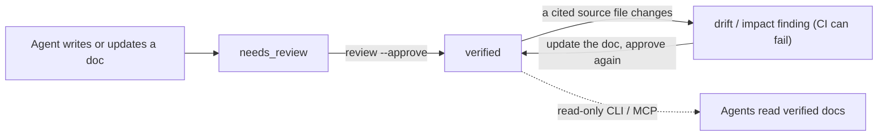

> Language: [English](./README.md) | [한국어](./README.ko.md)

# LLM-WIKI Governance

[](https://www.npmjs.com/package/llm-wiki-governance) [](https://github.com/Dowon-Kim7949/llm-wiki-governance/actions/workflows/ci.yml) [](./LICENSE)

**Review states, source citations, and drift checks for the project knowledge your AI coding agent writes and reads.**

Coding agents are good at writing project docs and bad at noticing when those docs stop being true. LLM-WIKI Governance is a zero-dependency CLI that holds that knowledge — a Markdown wiki in `docs/llm-wiki/` — to the same discipline as code. Agent-written docs stay `needs_review` until someone approves them. Every doc cites the files it describes. When a cited file changes, the doc gets flagged and CI can fail on it. It needs Node.js ≥ 18.18, works alongside Claude Code, Codex, Cursor and other agents, and is OKF-compatible.

```text
Without:  task -> re-scan the codebase -> re-derive structure & rules -> work
With:     task -> read index.md -> read the relevant (verified) wiki docs -> inspect only the source you need -> work
```

## How it works



1. **Scaffold.** `quickstart --write` creates the wiki, plus adapter files (`AGENTS.md`, `CLAUDE.md`, …) that point your agent at it.
2. **Enrich.** Your agent fills the docs from real source files and cites them in frontmatter (`source_files`, `evidence`). The CLI checks that each citation resolves.
3. **Review.** Docs stay `needs_review` until `review --approve` stamps them `verified`. No other command promotes a doc.
4. **Watch.** `drift` (by review date) and `impact` (by diff against a PR base) flag `verified` docs whose cited sources changed. With `validate` and `impact` in CI, a stale doc fails the build instead of quietly going wrong.

## Quick start

```bash
npm install -D llm-wiki-governance
npx llm-wiki-governance quickstart --write --type frontend --agent claude   # or --agent codex
```

`quickstart --write` detects the project, creates the wiki and adapter files, and prints a handoff prompt. Paste that prompt into your agent. It reads `docs/llm-wiki/index.md`, fills in the docs from real source files, and leaves everything `needs_review` for you to approve. To see what would be created first, run `quickstart --dry-run`.

Add `--skills` (or `--agent claude|codex|cursor`) to also generate invocable, wiki-grounded automation prompts: `bootstrap`, `onboard`, `prepare`, `feature`, `fix`, `docs-sync`, and `backfill`. If you already keep an OKF or plain-Markdown knowledge folder, point the CLI at it. `--profile okf-v0.1` adds verification, drift detection, and CI without changing your format.

The CLI itself needs no model. Only the enrichment step does, and that step decides quality. Use your agent's strongest reasoning model for the first wiki build; routine `docs-sync` runs fine on a cheaper one.

## Why not just an AGENTS.md or CLAUDE.md?

Keep those files: this tool generates them and points them at the wiki. An instruction file tells an agent how to work. It does not record whether a statement was reviewed, which code it came from, or whether that code has changed since. That record is what this tool adds.

| | Instruction file alone | With LLM-WIKI Governance |
| --- | --- | --- |
| Who approved this text? | unrecorded | `needs_review` → `verified`, with `reviewed_by` and `reviewed_at` |
| What is it based on? | prose | cited files, line ranges, symbols, or sections, each checked to resolve |
| Is it still current? | you find out when the agent gets it wrong | `drift` / `impact` flag the doc when a cited file changes |
| Is any of it enforced? | no | `validate` and `impact` exit non-zero in pre-commit or CI |
| How do agents read it? | the whole file, every session | a small index, then targeted reads through the CLI or MCP |

## What you get

- **Trust states.** AI-written docs start as `needs_review`. Only an explicit `review --approve` promotes a doc to `verified`. No other command and no MCP tool can do it.
- **Checked citations.** A doc cites files, line ranges, symbols, or Markdown sections, and `validate` fails when a citation no longer resolves.
- **Drift and impact.** When a cited source changes, `drift` and `impact` flag the `verified` doc for re-review.
- **CI enforcement.** `validate` and `impact` exit non-zero, so pre-commit or GitHub Actions can block an unreviewed or stale wiki. How hard they block depends on the [governance mode](#governance-modes).
- **Agent-queryable.** Read-only retrieval through the CLI and MCP, with sensitive-looking lines redacted.
- **Safe by construction.** Writes are preview-first, the change log is append-only, sensitive-looking values block the check instead of passing with a warning, and there are no runtime dependencies.

## What it does not do

- **It does not check that the prose is true.** It checks that each citation resolves: the file exists, the line range fits, the symbol is mentioned, the section heading exists. Whether the sentence citing it is correct is still for the reviewer to judge.
- **It does not write your docs.** The CLI scaffolds, checks, and prints prompts. Your agent writes the content, and that step decides quality.
- **It cannot prove who approved.** `reviewed_by` records the name given to `review --approve`. If agents approve docs in your repo, list them under `agentReviewers` in `llm-wiki.config.json` so `stats` counts their approvals separately. Branch protection, not this tool, controls who can merge. This repository's own wiki is a case in point: an agent approves it under the agent's own name, by a recorded maintainer decision ([AGENTS.md](./AGENTS.md)), and `stats` counts those approvals apart from human ones.
- **It is not semantic search.** Retrieval is keyword-based over the wiki. There are no embeddings and no index service.
- **It is not a hosted service.** It runs on your machine or in your CI. The CLI makes no network calls of its own.
- **Drift detection is file-level, and the date-based check has blind spots** that depend on your merge strategy. `impact --since <base>` is diff-based and avoids them. See [Wiring the gate](https://github.com/Dowon-Kim7949/llm-wiki-governance/blob/main/docs/OPERATIONS.md#wiring-the-gate-the-step-most-repos-skip).

## Commands

| Command | What it does |
| --- | --- |
| `quickstart` · `init` | Set up the wiki and adapter files, then print the agent handoff prompt. |
| `validate` · `audit` · `status` | Structure and safety validation for local checks and CI · full findings report · current wiki state. |
| `drift` · `impact` | Flag documents whose cited source has moved — by date, and by diff against a PR baseline. |
| `review` | Risk-ranked `needs_review` backlog; `--approve` is the only path to `verified`. |
| `mode` · `backfill` | Read or change the governance level · rebuild an incomplete wiki from what the repository can prove. |
| `onboard` · `prepare` | Learn a work area, or scope a change before implementing it. Read-only. |
| `list-docs` · `search-docs` · `get-doc` · `get-related` | Read-only retrieval that returns document content, with sensitive-looking lines redacted. |
| `graph` · `stats` | Knowledge graph (text/JSON/Mermaid/DOT) · health snapshot. |
| `doctor` · `next` · `explain` | Check the runtime, project detection, and CI wiring · suggest the next action · explain a finding and how to fix it. |
| `mcp` | Run the read-only MCP server. |
| `fix` · `migrate` · `archive-log` · `handoff` · `prompt` · `check-run` · `harness-health` · `import-memory` | Scoped autofix, contract upgrade, change-log volumes, agent prompts, and harness checks. |

Writes happen only with an explicit `--write`, `--apply`, or `--approve`; every other command is read-only. Add `--lang ko` for Korean findings messages, or `--doc-lang ko` to generate the wiki content in Korean. You can also import the package instead of shelling out (`import { commands, run } from "llm-wiki-governance"`). Run `npx llm-wiki-governance help <command>` for the full offline reference, in English.

## Run it in CI

Copy [`templates/github-actions/llm-wiki-validate.yml`](https://github.com/Dowon-Kim7949/llm-wiki-governance/blob/main/templates/github-actions/llm-wiki-validate.yml), or reference the composite action in one step with an exact tag: `uses: Dowon-Kim7949/llm-wiki-governance/.github/actions/validate@v1.35.0`. Recipes sized to your repo are in [docs/OPERATIONS.md](https://github.com/Dowon-Kim7949/llm-wiki-governance/blob/main/docs/OPERATIONS.md).

Since 1.35.0 the composite action also appends the text report to the job summary (`summary: "false"` turns that off; the step's exit code is unchanged). For `impact`, that report includes a table of the documents to re-review and the changed sources each one cites, and `--format json` carries the same as `impactedDocuments`.

On a private repository, runner minutes come out of an allowance the whole organization shares. Two channels cost nothing: `templates/git-hooks/pre-commit` needs no runner at all, and the workflow template reads its `runs-on` from a `LLM_WIKI_RUNNER` variable, so it can point at a self-hosted runner without editing the file. OPERATIONS.md covers what each one gives up.

## Governance modes

How much documentation you maintain should match what the project needs now. One engine, three policy levels, switchable at any time in the same repository.

| | `lite` | `standard` | `strict` |
| --- | --- | --- | --- |
| Intent | development speed | speed and knowledge | completeness, verification, handoff |
| Docs after a code change | only what the code cannot show | when a domain, architecture, or contract moves | every affected document |
| Drift and missing-doc gate | off | reports (warning) | fails the build (error) |
| `audit` · `backfill` | on demand | on demand | core workflow |

```json
{ "governance": { "mode": "lite" } }
```

`init` and `quickstart` scaffold `lite` for a brand-new project, so a fresh setup does not fail builds on drift until you raise the mode. A project with no `governance` block resolves to `strict`, which is exactly the rule set this CLI enforced before modes existed, so upgrading changes nothing until you opt in. Structural and safety checks run in every mode: malformed frontmatter, a dangling `source_files` path, a broken link, and sensitive-info detection are never dialed down.

The intended path is months in `lite`, then `strict` before a handoff. `llm-wiki mode set strict --write` writes one config key and runs no scan. `llm-wiki backfill` does the expensive reconstruction when you ask for it. It labels every fact `verified`, `inferred`, or `unknown`, and never invents a rationale nobody recorded.

**Before you add `impact` to a required check:** under `strict`, `impact.source_changed` defaults to `error`, so `llm-wiki impact --since <ref>` fails a build without any flag. Set `governance.mode` to `standard` (advisory) or `lite` (off), or pin `"impact.source_changed": "warning"` in the `rules` map of `llm-wiki.config.json`. Background, the measured false-positive rates, and every escape hatch: [CHANGELOG.md](./CHANGELOG.md) (1.28.0).

## Agent-native (MCP)

`llm-wiki mcp` runs a [Model Context Protocol](https://modelcontextprotocol.io) server over stdio, using Node built-ins only. Register it in an MCP client:

```json
{ "mcpServers": { "llm-wiki": { "command": "npx", "args": ["-y", "llm-wiki-governance", "mcp"] } } }
```

Every exposed tool is read-only. An agent can query the wiki but never write to it, and promotion to `verified` stays a CLI action. The server assumes a local stdio subprocess and has no authentication, so do not put it on a network without your own auth proxy. The trust model is in [SECURITY.md](./SECURITY.md#mcp-server-trust-model).

## What it takes to run

- **Setup:** one `quickstart --write`, then one enrichment session with your agent. That session is where model cost and quality are decided.
- **Day to day:** when `drift` or `impact` flags a doc, update it and approve it again. In `lite`, only what the code cannot show needs a doc at all.
- **CI:** one job, or the runner-free pre-commit hook.
- **Value comes from maintained content, not from the tooling.** In our benchmark (one external repository, one model, six tasks), a wiki that existed but was never enriched measured *worse* than no wiki at all. The conditions, and the runs that went against us, are in [BENCHMARK.md](https://github.com/Dowon-Kim7949/llm-wiki-governance/blob/main/docs/llm-wiki/BENCHMARK.md) (Korean prose) and [BENCHMARK_DISCLOSURE.md](https://github.com/Dowon-Kim7949/llm-wiki-governance/blob/main/docs/BENCHMARK_DISCLOSURE.md).

## Supported environments

| | |
| --- | --- |
| **Runtime** | Node.js ≥ 18.18.0 · Windows, macOS, Linux |
| **Dependencies** | none — no runtime third-party dependencies |
| **Detects** | Node · Python · Go · Rust · JVM · PHP · Ruby · .NET · mobile (Android / Flutter / iOS / React Native) · infra (Docker / Compose / Kubernetes / Helm / Terraform) |
| **Standards** | OKF-compatible — `--profile okf-v0.1` validates Open Knowledge Format `type`/`aliases`/`tags` |
| **Agents / editors** | Adapter files for Codex (`AGENTS.md`), Claude Code (`CLAUDE.md`), Cursor, GitHub Copilot, Windsurf, Gemini CLI — plus any MCP client |
| **Standalone** | the CLI works fully without any agent |

## Troubleshooting

| Symptom | First step |
| --- | --- |
| `npx` runs an older version than the latest release | npx can reuse a cached copy. Run `npx llm-wiki-governance@latest …`, or install it as a devDependency. |
| A finding you do not recognize | `llm-wiki explain <rule>` explains it and suggests a safe fix. |
| Unsure whether setup or CI wiring is right | `llm-wiki doctor` reports runtime, detection, and how many CI steps can actually block. |
| `sensitive.redacted` blocks a document | [When the sensitive-info scan blocks you](https://github.com/Dowon-Kim7949/llm-wiki-governance/blob/main/docs/OPERATIONS.md#when-the-sensitive-info-scan-blocks-you) |
| `impact` fails a build you did not expect | Check `governance.mode`, then see [Governance modes](#governance-modes). |

## Documentation

| If you want to… | Read |
| --- | --- |
| Run it at your repository's scale and wire CI | [docs/OPERATIONS.md](https://github.com/Dowon-Kim7949/llm-wiki-governance/blob/main/docs/OPERATIONS.md) |
| Look up every command, option, and exit code | `npx llm-wiki-governance help <command>` · [PUBLIC_API.md](https://github.com/Dowon-Kim7949/llm-wiki-governance/blob/main/docs/llm-wiki/PUBLIC_API.md) (Korean prose) |
| Understand the trust model or report a vulnerability | [SECURITY.md](./SECURITY.md) |
| See what was measured, and what was not | [BENCHMARK.md](https://github.com/Dowon-Kim7949/llm-wiki-governance/blob/main/docs/llm-wiki/BENCHMARK.md) (Korean prose) · [BENCHMARK_DISCLOSURE.md](https://github.com/Dowon-Kim7949/llm-wiki-governance/blob/main/docs/BENCHMARK_DISCLOSURE.md) |
| Follow worked examples | [EXAMPLES.md](https://github.com/Dowon-Kim7949/llm-wiki-governance/blob/main/docs/llm-wiki/EXAMPLES.md) (Korean prose) |
| Read history and direction | [CHANGELOG.md](./CHANGELOG.md) · [ROADMAP.md](./ROADMAP.md) |
| Check accepted safety scopes and release gates | [GATE_REVIEW.md](./GATE_REVIEW.md) (a long decision record) |

## Contributing and support

Bug reports and questions: [Issues](https://github.com/Dowon-Kim7949/llm-wiki-governance/issues) and [Discussions](https://github.com/Dowon-Kim7949/llm-wiki-governance/discussions). Security reports follow [SECURITY.md](./SECURITY.md). Before opening a pull request, read [CONTRIBUTING.md](./CONTRIBUTING.md) and the [Code of Conduct](./CODE_OF_CONDUCT.md). Licensed under [MIT](./LICENSE).
