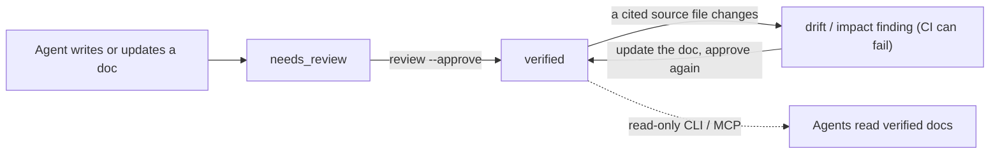

> Language: [English](./README.md) | [한국어](./README.ko.md)

# LLM-WIKI Governance

[](https://www.npmjs.com/package/llm-wiki-governance) [](https://github.com/Dowon-Kim7949/llm-wiki-governance/actions/workflows/ci.yml) [](./LICENSE)

**Review states, source citations, and drift checks for the project knowledge your AI coding agent writes and reads.**

Coding agents are good at writing project docs and bad at noticing when those docs stop being true. LLM-WIKI Governance is a zero-dependency CLI that holds that knowledge — a Markdown wiki in `docs/llm-wiki/` — to the same discipline as code. Agent-written docs stay `needs_review` until someone approves them. Every doc cites the files it describes. When a cited file changes, the doc gets flagged and CI can fail on it. It needs Node.js ≥ 18.18, works alongside Claude Code, Codex, Cursor and other agents, and is OKF-compatible.



1. **Scaffold.** `quickstart --write` creates the wiki, plus adapter files (`AGENTS.md`, `CLAUDE.md`, …) that point your agent at it.
2. **Enrich.** Your agent fills the docs from real source files and cites them in frontmatter (`source_files`, `evidence`). The CLI checks that each citation resolves.
3. **Review.** Docs stay `needs_review` until `review --approve` stamps them `verified`. No other command promotes a doc.
4. **Watch.** `drift` (by review date) and `impact` (by diff against a PR base) flag `verified` docs whose cited sources changed, and CI can fail on them.

## Quick start

```bash
npm install -D llm-wiki-governance
npx llm-wiki-governance quickstart --write --type frontend --agent claude   # or --agent codex
```

This detects the project, creates the wiki and adapter files, and prints a handoff prompt. Paste it into your agent: it fills in the docs from real source files and leaves everything `needs_review` for you to approve. `quickstart --dry-run` shows what would be created; `--skills` also generates wiki-grounded agent prompts (`bootstrap`, `onboard`, `prepare`, `feature`, `fix`, `docs-sync`, `backfill`). An existing OKF or plain-Markdown folder works too: `--profile okf-v0.1` adds verification and CI without changing your format.

The CLI needs no model. The enrichment step does, and it decides quality: use your strongest reasoning model for the first build.

**Starting a project that has no code yet** (`--greenfield`, 1.38.0): `quickstart --write --greenfield` adds requirement and decision (ADR) documents and prints a planning prompt. Your agent records the purpose, requirements, acceptance criteria, and decisions you state, invents none, and cites no source. Approving a requirement approves the plan, not an implementation: `validate` reports an approved plan with nothing linked as info, and `stats` counts plans apart. Once code exists, link each requirement's source files and tests in its `evidence`. From then on it is checked like any other doc, and the existing-project steps above apply. When an approved requirement or decision changes later, `impact` lists the files it links and whether each changed in the same diff (1.39.0, info); it names what to re-check and judges nothing. [`examples/greenfield-vue-demo`](https://github.com/Dowon-Kim7949/llm-wiki-governance/tree/main/examples/greenfield-vue-demo) runs this path from an empty repository.

**Demo.** [`examples/vue3-typescript-demo`](https://github.com/Dowon-Kim7949/llm-wiki-governance/tree/main/examples/vue3-typescript-demo) runs the whole loop on a small Vue 3 app in a temporary git repo (`npm install && npm run demo`, Node.js 20.19+, no API key): two source-backed docs, `validate --strict`, `review --approve`, then a code change that makes `impact` exit 1 until the doc is updated. It also shows the limits: a doc updated with the *wrong* number passes, and date-based `drift` misses a change committed the same day as the review.

## Why not just an AGENTS.md or CLAUDE.md?

Keep them: this tool generates them and points them at the wiki. An instruction file tells an agent how to work. It does not record whether a statement was reviewed, which code it came from, or whether that code has changed since.

| | Instruction file alone | With LLM-WIKI Governance |
| --- | --- | --- |
| Who approved this text? | unrecorded | `needs_review` → `verified`, with `reviewed_by` and `reviewed_at` |
| What is it based on? | prose | cited files, line ranges, symbols, or sections, each checked to resolve |
| Is it still current? | you find out when the agent gets it wrong | `drift` / `impact` flag the doc when a cited source changes |
| Is any of it enforced? | no | `validate` and `impact` exit non-zero in pre-commit or CI |
| How do agents read it? | the whole file, every session | a small index, then ranked keyword search and targeted reads through the CLI or MCP |

## What it does not do

- **It does not check that the prose is true.** It checks that each citation resolves: the file exists, the line range fits, the symbol is mentioned, the section heading exists. Whether the sentence is correct is still the reviewer's call.
- **It does not write your docs.** The CLI scaffolds, checks, and prints prompts; your agent writes the content.
- **It cannot prove who approved.** `reviewed_by` records the name given to `review --approve`. List agent names under `agentReviewers` so `stats` counts their approvals apart; branch protection, not this tool, controls who can merge. This repository's own wiki is agent-approved by a recorded maintainer decision ([AGENTS.md](./AGENTS.md)).
- **It is not semantic search.** Retrieval ranks keyword matches (BM25); there are no embeddings and no index service. It is not a hosted service either: the CLI makes no network calls of its own.
- **Change detection is mostly file-level.** `impact` and `drift` narrow only citations that are line ranges or Markdown sections, and since 1.39.0 `drift` narrows only when the commit that recorded the review agrees; the date-based `drift` also has blind spots that depend on your merge strategy. See [Wiring the gate](https://github.com/Dowon-Kim7949/llm-wiki-governance/blob/main/docs/OPERATIONS.md#wiring-the-gate-the-step-most-repos-skip).

## Commands

| Command | What it does |
| --- | --- |
| `quickstart` · `init` | Set up the wiki and adapter files, then print the agent handoff prompt. |
| `validate` · `audit` · `status` | Structure and safety validation for local checks and CI · full findings report · current wiki state. |
| `drift` · `impact` | Flag documents whose cited source has moved — by date, and by diff against a PR baseline. |
| `review` | Risk-ranked `needs_review` backlog; `--approve` is the only path to `verified`. |
| `mode` · `backfill` | Read or change the governance level · rebuild an incomplete wiki from what the repository can prove. |
| `onboard` · `prepare` | Learn a work area, or scope a change before implementing it. Read-only. |
| `list-docs` · `search-docs` · `get-doc` · `get-related` | Read-only retrieval that returns document content, with sensitive-looking values redacted. |
| `graph` · `stats` | Knowledge graph (text/JSON/Mermaid/DOT) · health snapshot. |
| `doctor` · `next` · `explain` | Check the runtime, detection, and CI wiring · suggest the next action · explain a finding. |
| `mcp` | Run the read-only MCP server. |
| `fix` · `migrate` · `archive-log` · `handoff` · `prompt` · `check-run` · `harness-health` · `import-memory` | Scoped autofix, contract upgrade, change-log volumes, agent prompts, and harness checks. |

Writes happen only with an explicit `--write`, `--apply`, or `--approve`. `--lang ko` gives Korean findings and `--doc-lang ko` generates Korean wiki content. The package can be imported instead of shelled out (`import { commands, run } from "llm-wiki-governance"`). `npx llm-wiki-governance help <command>` is the full offline reference; `--version` prints the installed version.

## Run it in CI

Copy [`templates/github-actions/llm-wiki-validate.yml`](https://github.com/Dowon-Kim7949/llm-wiki-governance/blob/main/templates/github-actions/llm-wiki-validate.yml), or use the composite action in one step: `uses: Dowon-Kim7949/llm-wiki-governance/.github/actions/validate@v1.39.0`. It appends the report to the job summary, including the documents `impact` wants re-reviewed (`summary: "false"` turns that off). On a private repository, the runner-free `templates/git-hooks/pre-commit` hook and the `LLM_WIKI_RUNNER` variable (self-hosted runner) avoid shared runner minutes. Recipes per repository size: [docs/OPERATIONS.md](https://github.com/Dowon-Kim7949/llm-wiki-governance/blob/main/docs/OPERATIONS.md).

## Governance modes

One engine, three policy levels, switchable at any time with `{ "governance": { "mode": "lite" } }` in `llm-wiki.config.json`.

| | `lite` | `standard` | `strict` |
| --- | --- | --- | --- |
| Intent | development speed | speed and knowledge | completeness, verification, handoff |
| Docs after a code change | only what the code cannot show | when a domain, architecture, or contract moves | every affected document |
| Drift and missing-doc gate | off | reports (warning) | fails the build (error) |

`quickstart` scaffolds `lite`. A config without a `governance` block resolves to `strict`, the rule set enforced before modes existed. Structural and safety checks run in every mode. A rule a mode turns off is only not reported: `stats` and `next` still measure enrichment and evidence, and `review` still refuses to approve an unfilled scaffold. The intended path is months in `lite`, then `mode set strict --write` and `backfill` before a handoff. **Before making `impact` a required check:** under `strict`, `impact.source_changed` is an `error`, so `impact --since <ref>` fails a build on its own; use `standard`, or pin `"impact.source_changed": "warning"` in `rules`.

## Agent-native (MCP)

`llm-wiki mcp` runs a [Model Context Protocol](https://modelcontextprotocol.io) server over stdio with Node built-ins only:

```json
{ "mcpServers": { "llm-wiki": { "command": "npx", "args": ["-y", "llm-wiki-governance", "mcp"] } } }
```

Every tool is read-only; promotion to `verified` stays a CLI action. The server has no authentication, so keep it a local subprocess ([SECURITY.md](./SECURITY.md#mcp-server-trust-model)).

## What it takes to run

Setup is one `quickstart --write` and one enrichment session. Day to day, when `drift` or `impact` flags a doc, update it and approve it again. **Value comes from maintained content, not from the tooling:** in our benchmark (one external repository, one model, six tasks), a wiki that existed but was never enriched measured *worse* than no wiki at all. Conditions and the runs that went against us: [BENCHMARK.md](https://github.com/Dowon-Kim7949/llm-wiki-governance/blob/main/docs/llm-wiki/BENCHMARK.md) (Korean prose) and [BENCHMARK_DISCLOSURE.md](https://github.com/Dowon-Kim7949/llm-wiki-governance/blob/main/docs/BENCHMARK_DISCLOSURE.md).

Runs on Windows, macOS, and Linux with no runtime dependencies. It detects Node, Python, Go, Rust, JVM, PHP, Ruby, .NET, mobile, and infra projects, and ships adapters for Codex, Claude Code, Cursor, GitHub Copilot, Windsurf, and Gemini CLI.

## Troubleshooting and documentation

| If you… | Then |
| --- | --- |
| get an older version from `npx` | `npx` can reuse a cache: run `npx llm-wiki-governance@latest …` and check with `--version`. |
| see a finding you do not recognize | `llm-wiki explain <rule>`. |
| are unsure about setup or CI wiring | `llm-wiki doctor`. |
| are blocked by `sensitive.redacted` | [When the sensitive-info scan blocks you](https://github.com/Dowon-Kim7949/llm-wiki-governance/blob/main/docs/OPERATIONS.md#when-the-sensitive-info-scan-blocks-you) |
| want every command, option, and exit code | `help <command>` · [PUBLIC_API.md](https://github.com/Dowon-Kim7949/llm-wiki-governance/blob/main/docs/llm-wiki/PUBLIC_API.md) (Korean prose) |
| want the trust model, or to report a vulnerability | [SECURITY.md](./SECURITY.md) |
| want worked examples | [EXAMPLES.md](https://github.com/Dowon-Kim7949/llm-wiki-governance/blob/main/docs/llm-wiki/EXAMPLES.md) (Korean prose) |
| want history, direction, or the decision record | [CHANGELOG.md](./CHANGELOG.md) · [ROADMAP.md](./ROADMAP.md) · [GATE_REVIEW.md](./GATE_REVIEW.md) |

Bug reports and questions: [Issues](https://github.com/Dowon-Kim7949/llm-wiki-governance/issues) and [Discussions](https://github.com/Dowon-Kim7949/llm-wiki-governance/discussions). Before a pull request, read [CONTRIBUTING.md](./CONTRIBUTING.md) and the [Code of Conduct](./CODE_OF_CONDUCT.md). Licensed under [MIT](./LICENSE).
